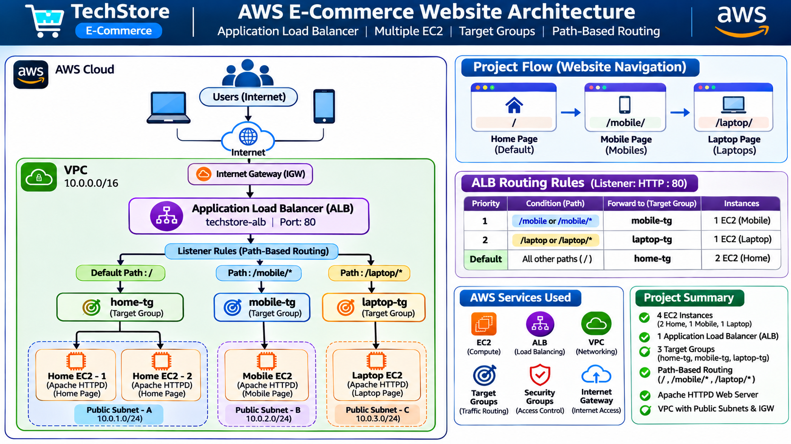

# TechStore – AWS E-Commerce Website using Application Load Balancer

A beginner-friendly AWS project that hosts a simple e-commerce frontend across four Amazon EC2 instances and uses an Application Load Balancer (ALB) with path-based routing to direct requests to separate Home, Mobile, and Laptop pages.

## Architecture



## Project overview

The TechStore website has three frontend pages:

- **Home page** – hosted on two EC2 instances for the default route.
- **Mobile page** – hosted on one EC2 instance and served under `/mobile/`.
- **Laptop page** – hosted on one EC2 instance and served under `/laptop/`.

The ALB listens on HTTP port 80 and forwards requests to the appropriate target group based on the URL path.

## AWS resources

| Resource | Name / configuration | Purpose |
|---|---|---|
| VPC | Project VPC | Network for the project |
| Internet Gateway | Attached to the VPC | Internet connectivity |
| EC2 instances | 4 Amazon Linux instances | Host the website pages |
| Application Load Balancer | `techstore-alb` | Receives and routes HTTP requests |
| Target Group 1 | `home-tg` | Home EC2-1 and Home EC2-2 |
| Target Group 2 | `mobile-tg` | Mobile EC2 |
| Target Group 3 | `laptop-tg` | Laptop EC2 |
| Security Groups | `alb-sg`, `new-sg` (as configured) | Control inbound traffic |
| Apache HTTP Server | `httpd` | Serves the HTML, CSS and JavaScript files |

> Update resource names in this README if your actual AWS console uses different names.

## EC2 and website mapping

| EC2 instance | Website files | Target group |
|---|---|---|
| Home EC2-1 | `/var/www/html/index.html` and its CSS/JS | `home-tg` |
| Home EC2-2 | `/var/www/html/index.html` and its CSS/JS | `home-tg` |
| Mobile EC2 | `/var/www/html/mobile/index.html`, `mobile.css`, `mobile.js` | `mobile-tg` |
| Laptop EC2 | `/var/www/html/laptop/index.html`, `laptop.css`, `laptop.js` | `laptop-tg` |

## ALB listener rules

Configure an HTTP listener on port **80** with these rules:

| Priority | Path condition | Forward action |
|---|---|---|
| 1 | `/mobile` and `/mobile/*` | `mobile-tg` |
| 2 | `/laptop` and `/laptop/*` | `laptop-tg` |
| Default | All other paths | `home-tg` |

The ALB forwards the original URL path to the target. It does not remove `/mobile` or `/laptop`. The Mobile and Laptop EC2 instances therefore serve their files from the matching directories under `/var/www/html`.

## Website URLs

Replace `YOUR-ALB-DNS-NAME` with the DNS name shown in the AWS EC2 Load Balancers console.

- Home: `http://YOUR-ALB-DNS-NAME/`
- Mobiles: `http://YOUR-ALB-DNS-NAME/mobile/`
- Laptops: `http://YOUR-ALB-DNS-NAME/laptop/`

The Home page navigation links point to `/`, `/mobile/`, and `/laptop/`.

## Security group guidance

A recommended security group arrangement is:

### ALB security group (`alb-sg`)

| Type | Port | Source |
|---|---:|---|
| HTTP | 80 | `0.0.0.0/0` |

### EC2 security group (`new-sg`)

| Type | Port | Source |
|---|---:|---|
| SSH | 22 | Your own public IP address (`/32`) |
| HTTP | 80 | The ALB security group |

This allows public HTTP traffic to reach the ALB while restricting web traffic to the EC2 instances to requests from the ALB. Confirm that your actual rules follow your instructor's requirements and security policy.

## Health checks

Configure each target group's health check path to a URL that returns HTTP status `200` on its registered instances:

| Target group | Suggested health check path |
|---|---|
| `home-tg` | `/` |
| `mobile-tg` | `/mobile/` |
| `laptop-tg` | `/laptop/` |

Wait for the registered targets to become **Healthy** before testing the ALB. If a target is unhealthy, check its Apache service, file location, security groups, health check path, and VPC/subnet routing.

## Deployment notes

Install and start Apache on each Amazon Linux instance:

```bash
sudo yum install httpd -y
sudo systemctl enable --now httpd
```

For the Mobile EC2 instance, place the three Mobile page files in:

```text
/var/www/html/mobile/
```

For the Laptop EC2 instance, place the three Laptop page files in:

```text
/var/www/html/laptop/
```

For both Home EC2 instances, place the Home page files directly in:

```text
/var/www/html/
```

Make sure the corresponding CSS and JavaScript files are in the same directory as their HTML file.

## Screenshots

Add your own AWS Console and browser screenshots to the `Screenshots/` folder. Suggested filenames:

1. `01-EC2-Instances.png`
2. `02-EC2-Instance-Details.png`
3. `03-ALB-Security-Group.png`
4. `04-EC2-Security-Group.png`
5. `05-Home-Target-Group.png`
6. `06-Mobile-Target-Group.png`
7. `07-Laptop-Target-Group.png`
8. `08-ALB-Overview.png`
9. `09-ALB-Listeners.png`
10. `10-ALB-Routing-Rules.png`
11. `11-Home-Page.png`
12. `12-Mobile-Page.png`
13. `13-Laptop-Page.png`
14. `14-Health-Checks.png`

Only add genuine screenshots from your own AWS account and browser. Hide account IDs, public IPs if you consider them sensitive, access keys, passwords, and other confidential information before publishing.

## What I learned

- Launching and configuring EC2 instances.
- Installing and managing Apache HTTP Server.
- Deploying static HTML, CSS, and JavaScript websites.
- Creating and registering Application Load Balancer target groups.
- Configuring ALB listeners and path-based routing.
- Using security groups to control access.
- Checking target health and testing application routes.

## Future improvements

- Add HTTPS using AWS Certificate Manager.
- Configure a custom domain using Amazon Route 53.
- Monitor ALB and EC2 using Amazon CloudWatch.
- Enable ALB access logs in Amazon S3.
- Add Auto Scaling for improved availability.
- Add a backend API, database, and functional shopping cart.

## Important note

This is a frontend demonstration project. The **Buy Now** buttons display JavaScript alerts only. This project does not implement real orders, payments, authentication, or database storage.

## Author

Add your name, GitHub profile, and project date here.
